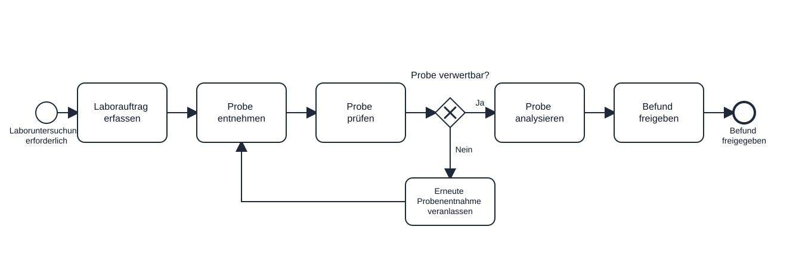

# Angewandte Informatik {#modul-i}

## Bestandteile einer IT-Infrastruktur

### Aufbau typischer Krankenhaus- und Praxisnetzwerke

::: {.exam-question .done}
Was sind die typischen Bestandteile eines Krankenhausnetzwerks?
:::

::: {.exam-answer}
- **Server:** stellen Anwendungen (z.B. KIS, PACS, LIS) und Daten bereit
- **Clients und Endgeräte:** greifen auf Dienste zu oder tauschen Daten aus
  - Stations-PCs, Visitenwagen, Netzwerkdrucker und Medizingeräte
- **Aktive Netzwerkkomponenten:** verarbeiten oder steuern Signale 
  - Switch, Router, WLAN-Access-Point
  - benötigen Strom
- **Passive Netzwerkkomponenten:** übertragen oder verbinden Signale 
  - Kabel, Netzwerkdosen und Patchpanels
  - Keine aktive Verarbeitung
  - benötigen kein Strom 
- **Sicherheitskomponenten und Netzwerksegmentierung:** Zugriffskontrolle, Netztrennung, Netzsicherheit
  - Firewalls (kontrollieren den Verkehr)
  - [VLANs](https://de.wikipedia.org/wiki/Virtual_Local_Area_Network) sind Pfeiler der Segmentierung und unterteilen das Krankenhaus in Zonen (Medizintechnik, Verwaltung und Gäste)

- **Externe Anbindungen:** verbinden die Klinik mit externen Diensten und Standorten
  - z.B. Internet, TI (Telematikinfrastruktur), VPN (Virtual Private Network)

Merksatz: Server stellen bereit, Clients greifen zu, Switches verbinden Geräte, Router verbinden Netze, Firewalls kontrollieren den Verkehr.

::: {.callout-note title="Good to know" appearance="simple"}
- Passive Infrastruktur nach [EN 50173](https://de.wikipedia.org/wiki/EN_50173) vs [Hierarchisches Internetworking-Modell](https://de.wikipedia.org/wiki/Hierarchisches_Internetworking-Modell)
- VLAN als Grundlage der Segmentierungf
- [ISO 80001-1](https://de.wikipedia.org/wiki/Risikomanagement_f%C3%BCr_medizinische_IT-Netzwerke)
:::
:::

### Client-Server-Konzept

::: {.exam-question .done}
Was ist das Client-Server-Konzept?
:::

::: {.exam-answer}
- **Client-Server-Konzept:** Aufgaben sind zwischen anfragendem Client und bereitstellendem Server aufgeteilt
  - **Client:** fordert Dienste/Daten an und verarbeitet die Antwort
    - Die KIS-Anwendung auf dem Stations-PC ruft einen Laborbefund ab
  - **Server:** verarbeitet Anfragen und stellt Dienste oder Daten bereit
    - Der KIS-Server liefert den angeforderten Laborbefund
    - **Aufgabenverteilung:** Gemeinsame Daten und Dienste werden häufig zentral bereitgestellt; Verarbeitung kann auf beiden Seiten erfolgen

Merksatz: Client fragt an, Server bearbeite und antwortet

::: {.callout-note title="Good to know" appearance="simple"}
- Client und Server bezeichnen Software-Rollen [Fielding], nicht zwingend getrennte Rechner. Ein Programm kann je nach Kommunikationspartner beide Rollen übernehmen.
- Client-Server und 3-Schichten-Modell
	- Client-Server legt nur zwei Rollen fest: Einer fragt an (Client), einer liefert (Server).
Das 3-Schichten-Modell sagt genauer, wo welche Arbeit erledigt wird.
:::

::: {.callout-note title="Zitate" appearance="simple"}
Fielding RT, Nottingham M, Reschke J (2022).
*HTTP Semantics*. RFC 9110, Abschnitt 3.3 „[Connections, Clients, and Servers](https://www.rfc-editor.org/rfc/rfc9110.html#section-3.3)“.

:::
:::

### Rechnertypen

::: {.exam-question .done}
Was unterscheidet Fat-, Thin- und Zero-Clients?
:::

::: {.exam-answer}

Entscheidend sind die Verteilung der Anwendungsverarbeitung und die lokale Softwareausstattung.

- **Fat Client:** führt Anwendungen überwiegend lokal aus; besitzt ein eigenes Betriebssystem
  - Praxis-PC mit lokal installierter Praxissoftware und Verbindung zum Datenbankserver
- **Thin Client:** nutzt überwiegend serverseitig ausgeführte Anwendungen; besitzt ein lokales, häufig reduziertes Betriebssystem
  - Am Stationsarbeitsplatz wird das KIS bedient; die Anwendung läuft auf einem zentralen Terminalserver
- **Zero Client:** spezialisiertes Endgerät für entfernte Anwendungen oder Desktops; nutzt typischerweise Firmware statt eines allgemeinen Anwendungsbetriebssystems
  - Stationsarbeitsplatz mit Zugriff auf einen virtuellen Desktop

Merksatz: Fat verarbeitet Anwendungen überwiegend lokal; Thin und Zero überwiegend serverseitig.

::: {.callout-note title="Gut zu wissen" appearance="simple"}
Auch Thin und Zero Clients verarbeiten Daten lokal, etwa zur Bilddarstellung und Übertragung von Tastatur- und Mauseingaben. Ein Zero Client ist deshalb mehr als ein Bildschirm.
:::
::: {.callout-note title="Zitate" appearance="simple"}

:::
:::

### Servertypen

::: {.exam-question .done}
Was sind typische Servertypen (Cluster, dediziert, virtuell, shared)?
:::


::: {.exam-answer}

Ein Server kann physischer Natur sein, eine Rolle (logische Funktion) einnehmen oder eine Schicht in der Anwendungsarchitektur sein. Die Begriffe bilden keine einheitliche, gegenseitig ausschließende Klassifikationen.

- **Physischer Server:** eigenständiger Hardware-Rechner, auf dem ein Serverbetriebssystem, Anwendungen oder ein Hyperviser laufen
	- Stellt Rechenleistung für mehrere KIS-Subsysteme (z.B. im eigenen Klinik-Rechenzentrum) 
- **Virtueller Server:** softwaredefinierte (?), von einem Hypervisor bereitgestellte Serverumgebung (?) mit eigenem Betriebssystem und zugewiesenen Ressourcen 
	- Eine VM betreibt den Applikationsserver des LIS
- **Dedizierter Server:** seine Ressourcen sind exklusiv einem Mandanten oder einem bestimmten Workload zugeordnet (kann physisch oder virtuell sein)
	- z.B. eine VM ist ausschließlich für die produktive LIS-Datenbank reserviert
- **Shared Server:** mehrere Anwendungen VMs oder Mandanten teilen sich Ressourcen einer Serverinfrastruktur. 
	- Ein physischer Virtualisierungshost stellt Rechenleistung für virtuelle Server von LIS, KIS und RIS bereit.
- **Cluster:** mehrere eingenständige Server oder Clusterknoten (?) arbeiten koordiniert zusammen
	- Zwei Datenbankserver stellen die KIS-Datenbank als Failovercluster bereit (Redundanz)
		- Failover-Cluster, Load-Balancing, High-Performance

Merksatz: Dediziert = ein Server, eine Aufgabe; shared = mehrere Aufgaben teilen sich einen Server; virtuell = viele logische Server auf einer Hardware; Cluster = mehrere Server als Team gegen Ausfall.

::: {.callout-note title="Good to know" appearance="simple"}
- Ein KIS läuft auf einem virtullen Server, dieser liegt auf einem Cluster mit mehreren physischen Hyperviser-Hosts, die sich einen shard Storage teilen. Die Datenbank bekommnt dedizierte Ressourcen zugewiesen, damit sie nicht mit mehreren VMs um CPU konkurriert.
- Servertypen können auch nach ihrer Funktions klassifiziert werdern (Datenbank-, Applikations-, Terminal-, Kommunikationsserver)
- Hyperviser: eine Software- oder Firmware-Schicht, die die physischen Ressourcen der Hardware (CPU, RAM, Festplatte) verwaltet und sie der VM als virtuelle Umgebung bereitstellt
:::
:::

### Betriebssysteme

::: {.exam-question .done}
Welche Betriebssysteme sind im Klinikkontext auf Clients, Servern, mobilen Endgeräten und Medizingeräten relevant?
:::

:::: {.exam-answer}

- **Stationäre Clients:** Windows sowie – abhängig von Anwendung und Arbeitsplatz – Linux, macOS oder spezielle Thin-Client-Betriebssysteme
	- Ein Windows-Arbeitsplatz in der Notaufnahme greift auf das Krankenhausinformationssystem (KIS) zu
	- Verzeichnisdienst (meist Microsoft Active Directory / AD): zentrale Datenbank und das „Telefonbuch“ des Netzwerks. Hier sind alle Benutzer (z. B. Ärztinnen, Pfleger), Computer, Drucker und Berechtigungen gespeichert.
- **Server:** Windows Server, Linux und Unix-Varianten wie Solaris
  	- Ein Windows-Server stellt den Verzeichnisdienst für die Klinikarbeitsplätze bereit
- **Mobile Endgeräte:** iOS beziehungsweise iPadOS und Android
  	- Ein zentral verwaltetes Tablet dient der mobilen Pflegedokumentation
- **Medizingeräte:** allgemeine oder eingebettete Betriebssysteme; bei zeitkritischen Funktionen auch Echtzeitbetriebssysteme (Real-Time Operating Systems, RTOS)
  	- Eine vernetzte Infusionspumpe kann ein eingebettetes Betriebssystem enthalten

Merksatz: Es gibt keine feste Zuordnung: Das Betriebssystem richtet sich nach Anwendung, Herstelleranforderungen, Support, Verwaltung und Sicherheitsanforderungen.

::: {.callout-note title="Gut zu wissen" appearance="simple"}

Bei Medizinprodukten müssen die Herstellerangaben zur unterstützten Betriebsumgebung berücksichtigt werden. Sicherheitsrelevante Softwareupdates gehören nach § 7 Abs. 2 MPBetreibV zur Instandhaltung. Netzsegmentierung ergänzt das Patchmanagement, ersetzt es aber nicht.

:::

::: {.callout-note title="Literatur" appearance="simple"}

- Bundesärztekammer: [(Muster-)Kursbuch Medizinische Informatik](https://www.bundesaerztekammer.de/fileadmin/user_upload/BAEK/Themen/Aus-Fort-Weiterbildung/Weiterbildung/Kursbuecher/2018/20220217_18_MKB_MedInformatik.pdf), 2. Auflage, 2022, Abschnitt 4.1, S. 10
- Winter A, Ammenwerth E, Haux R et al.: *Health Information Systems: Technological and Management Perspectives*, 3. Auflage, Springer 2023, Kapitel 3, Abschnitte 3.10.1.1 und 3.10.1.2, [DOI: 10.1007/978-3-031-12310-8_3](https://doi.org/10.1007/978-3-031-12310-8_3)
- NIST: *Guidelines for Managing the Security of Mobile Devices in the Enterprise*, SP 800-124 Rev. 2, 2023, Abschnitt 4.2.1, [DOI: 10.6028/NIST.SP.800-124r2](https://doi.org/10.6028/NIST.SP.800-124r2)
- MDCG: [Guidance on Cybersecurity for Medical Devices, MDCG 2019-16 Rev. 1](https://health.ec.europa.eu/system/files/2022-01/md_cybersecurity_en.pdf), 2020, Abschnitte 3.6 und 3.7
- [§ 7 Abs. 2 Medizinprodukte-Betreiberverordnung](https://www.gesetze-im-internet.de/mpbetreibv_2025/__7.html)

:::
::::

### Schnittstellen

::: {.exam-question .done .done}
Was ist der Unterschied zwischen Hardware- und Software-Schnittstellen sowie internen und externen Schnittstellen?
:::

:::: {.exam-answer}

- **Hardware-Schnittstelle:** Physische und elektrische Verbindung zwischen technischen Geräten zur Signalübertragung.
  - Beispiel: Die serielle RS-232-Verbindung eines Intensivmonitors an einen Datenkonzentrator.
- **Software-Schnittstelle:** Logische Vereinbarung aus Format, Protokoll und Semantik zum Datenaustausch zwischen Anwendungsprogrammen.
  - Beispiel: Eine REST-API nach dem FHIR-Standard zur Abfrage von Patientendaten durch eine App.
- **Interne Schnittstelle:** Schnittstelle zum Datenaustausch innerhalb einer definierten System- oder Organisationsgrenze.
  - Beispiel: Die Schnittstelle zwischen dem Patientenaufnahmemodul und dem Abrechnungsmodul im Krankenhausinformationssystem.
- **Externe Schnittstelle:** Schnittstelle zum Datenaustausch über eine festgelegte System- oder Organisationsgrenze hinweg.
  - Beispiel: Die Anbindung des Krankenhauses an die Telematikinfrastruktur zur Prüfung des Versichertenstammdatenmanagements.

Merksatz: Hardware verbindet Geräte physisch, Software Programme logisch – ob intern oder extern, bestimmt einzig die gewählte Systemgrenze.

::: {.callout-note title="Gut zu wissen" appearance="simple"}
„Intern“ und „extern“ sind relative Begriffe. Eine Schnittstelle zum Laborrechner eines Fremdherstellers im selben Raum ist technisch intern im Kliniknetz, aber logisch-organisatorisch eine externe Systemgrenze. In Prüfungen sollte stets das Bezugssystem angegeben werden.
:::
::::

### Aufbau, Funktionsweise und Komponenten der Telematik-Infrastruktur

::: {.exam-question .done}
Welche Kernkomponenten braucht die Telematikinfrastruktur (TI)?
:::

:::: {.exam-answer}

- **Identifikations- und Authentisierungskomponenten:** Personen- und institutionsbezogene Chipkarten zur Identifikation, Authentisierung und Berechtigungsprüfung
  - **elektronische Gesundheitskarte (eGK):** Versichertennachweis, Authentisierungsmittel und Träger von Versichertenstammdaten
    - Beispiel: Ein Patient legt die eGK bei der Anmeldung in der Arztpraxis vor
  - **Security Module Card Typ B (SMC-B):** Institutionsausweis zur Authentisierung einer Praxis, Klinik oder Apotheke
    - Beispiel: Bei kartenbasierter Nutzung befindet sich die SMC-B im E-Health-Kartenterminal und authentisiert die Praxis
  - **elektronischer Heilberufsausweis (HBA):** personenbezogener Berufsausweis für Leistungserbringende, unter anderem zur qualifizierten elektronischen Signatur (QES)
    - Beispiel: Eine Ärztin signiert ein E-Rezept mit ihrem HBA

- **Zugangskomponenten vor Ort:** Komponenten zur Anbindung der Einrichtung an die TI
  - **Konnektor:** Sicherheitsgateway zwischen dem Netz der Einrichtung und der TI; alternativ kann ein TI-Gateway verwendet werden
    - Beispiel: Ein im KIS integriertes ePA-Modul greift über den TI-Zugang auf die elektronische Patientenakte zu
  - **E-Health-Kartenterminal:** von der gematik zugelassenes Lesegerät für eGK, SMC-B und HBA
    - Beispiel: Das Kartenterminal am Aufnahmeschalter liest die eGK ein

- **Netz und zentrale Dienste:** ermöglichen die geschützte Kommunikation und Adressierung
  - **VPN-Zugangsdienst:** stellt beim klassischen Konnektor die gesicherte Verbindung zur zentralen TI-Plattform her
    - Beispiel: Der Konnektor verbindet sich über den VPN-Zugangsdienst mit den TI-Diensten
  - **Verzeichnisdienst (VZD):** zentrales Adressbuch für registrierte Leistungserbringende, Einrichtungen und weitere Organisationen
    - Beispiel: Eine Praxis sucht die KIM-Adresse einer weiterbehandelnden Klinik im VZD

- **Fachanwendungen:** medizinische und administrative Anwendungen der TI
  - **Fachdienste und Anwendungssysteme:** stellen Funktionen für TI-Anwendungen bereit
    - Beispiel: Abruf und Einstellung von Dokumenten in der elektronischen Patientenakte (ePA)
  - **VSDM-Fachdienste:** ermöglichen die Onlineprüfung von Versichertenstammdaten
    - Beispiel: Durchführung des Versichertenstammdatenmanagements (VSDM) beim Einlesen der eGK
  - **Kartengestützte Anwendungen:** speichern bestimmte medizinische Daten dezentral auf der eGK
    - Beispiel: Auslesen eines Notfalldatensatzes des Notfalldatenmanagements (NFDM) von der eGK

Merksatz: Karten und digitale Identitäten weisen Personen und Einrichtungen aus, Zugangskomponenten verbinden mit der TI, und Fachanwendungen erfüllen den medizinischen oder administrativen Zweck.

::: {.callout-note title="Gut zu wissen" appearance="simple"}

Beim TI-Gateway entfällt der eigene Konnektor vor Ort. Ein lokales Hard- oder Software-Zugangsmodul verbindet die Einrichtung per VPN mit einem zentral betriebenen Highspeed-Konnektor. Die TI 2.0 soll den Zugang durch digitale Identitäten und eine Zero-Trust-Architektur weiterentwickeln.

HBA ist nicht ausschließlich auf approbierte Berufe beschränkt

VZD: "bildet die Basis für sichere Kommunikation mit KIM und TI‑Messenger sowie für weitere TI‑Anwendungen wie E-Rezept und der elektronischen Patientenakte (ePA)." (https://www.gematik.de/telematikinfrastruktur/verzeichnisdienst-vzd)

:::

::: {.callout-note title="Literatur" appearance="simple"}

- Bundesärztekammer: [(Muster-)Kursbuch Medizinische Informatik](https://www.bundesaerztekammer.de/fileadmin/user_upload/BAEK/Themen/Aus-Fort-Weiterbildung/Weiterbildung/Kursbuecher/2018/20220217_18_MKB_MedInformatik.pdf), 2. Auflage, 2022, Abschnitt 4.1, S. 10
- gematik: [Übergreifendes Datenschutz- und Sicherheitskonzept der TI](https://gemspec.gematik.de/docs/gemKPT/gemKPT_DS_Sich_TI/), Version 3.2.2, 2026, Abschnitte 4.1 und 4.4
- gematik: [TI-Zugang](https://www.gematik.de/telematikinfrastruktur/ti-zugang), Abschnitt „Was brauche ich, um einen TI-Zugang einzurichten?“
- gematik: [TI-Gateway](https://www.gematik.de/telematikinfrastruktur/ti-zugang/ti-gateway), Abschnitt „So funktioniert das TI-Gateway“

Quellen geprüft am 3. November 2026.

:::
::::

## Programme und Datenbanken

### Programmbestandteile und Kontrollstrukturen

::: {.exam-question .don .done}
Welche typischen Bestandteile enthält der Quellcode eines Programms?
:::

:::: {.exam-answer}

- **Anweisungen (Statements):** führen einzelne Verarbeitungsschritte aus
  - Beispiele sind Zuweisungen, Funktionsaufrufe und Rückgaben
- **Variablen und Datentypen:** Variablen bezeichnen Werte; der Datentyp bestimmt deren mögliche Werte und Operationen
  - Beispiele sind Ganzzahlen, Gleitkommazahlen, Text und Wahrheitswerte
- **Kontrollstrukturen:** steuern, in welcher Reihenfolge Anweisungen ausgeführt werden
  - **Sequenz:** Anweisungen werden nacheinander ausgeführt
  - **Selektion:** abhängig von einer Bedingung wird ein Zweig ausgewählt, z. B. mit `if–else`
  - **Iteration:** Anweisungen werden wiederholt, z. B. mit `for`, `while` oder `do–while`
- **Funktionen und Methoden:** fassen Anweisungen zu wiederverwendbaren Teilaufgaben zusammen
  - Eine Methode ist einer Klasse oder einem Objekt zugeordnet
- **Kommentare:** erklären den Quellcode für Menschen und werden normalerweise nicht ausgeführt
- **Ein- und Ausgabe (Input/Output, I/O):** ermöglichen den Datenaustausch mit Nutzern, Dateien, Datenbanken oder anderen Systemen

**Beispiel in Python:**

```{.python}
def filtere_werte(werte, grenzwert):                 # <1>
    ergebnis = []                                    # <2>

    for wert in werte:                               # <3>
        if wert > grenzwert:                         # <4>
            ergebnis.append(wert)                    # <5>

    return ergebnis                                  # <6>

kalium_werte = [4.2, 5.5, 4.8, 6.1]                  # <7>
auffaellige_werte = filtere_werte(kalium_werte, 5.0) # <8>
print(auffaellige_werte)                             # <9>
```
1. Funktionsdefinition mit zwei Parametern
2. Variable mit Zuweisung einer leeren Liste
3. Iteration über die übergebenen Werte
4. Selektion: Prüfung der Bedingung
5. Methodenaufruf auf dem Listenobjekt
6. Rückgabe an die aufrufende Stelle
7. Vereinfachte

Das Beispiel filtert Werte anhand eines ausschließlich zu Lehrzwecken festgelegten Schwellenwerts. Es stellt keine medizinische Entscheidungsregel dar.

Merksatz: Anweisungen führen aus, Variablen halten Werte, Kontrollstrukturen steuern, Funktionen gliedern, Kommentare erklären und Ein- und Ausgabe verbinden das Programm mit seiner Umgebung.

::: {.callout-note title="Gut zu wissen" appearance="simple"}

Nicht jedes Programm enthält alle genannten Bestandteile. Kommentare gehören zum Quelltext, aber nicht zur ausgeführten Programmlogik.

:::

::: {.callout-note title="Literatur" appearance="simple"}

- Bundesärztekammer: *(Muster-)Kursbuch Medizinische Informatik*. 2. Auflage, 2022, Abschnitt 4.1 „Modul I – Angewandte Informatik“, S. 10.
- Python Software Foundation: *The Python Language Reference*, Kapitel 2.1.3, 3.1, 7 und 8. Onlinefassung, geprüft am 04.11.2026.

:::
::::

### Ein- und Ausgabe, Bedingungen und Schleifen

:::: {.exam-question .done}
Wie werden Ein- und Ausgabe, Bedingungen und Schleifen in einer
Programmiersprache umgesetzt?
::::

:::: {.exam-answer}

- **Eingabe:** Daten gelangen von außen in das Programm. In Python liest `input()` von der Tastatur und liefert das Ergebnis **immer als Zeichenkette**.
  - Zahlen müssen umgewandelt werden, etwa mit `int()` oder `float()` — sonst scheitert jeder Vergleich mit einem Zahlenwert.

**Ein- und Ausgabe mit Typumwandlung:**

```{.python}
eingabe = input("Kaliumwert in mmol/l: ")    # <1>
kalium = float(eingabe)                      # <2>
print("Erfasster Wert:", kalium)             # <3>
```
1. `input()` liefert eine Zeichenkette, zum Beispiel `"5.5"`
2. Umwandlung in eine Gleitkommazahl — ohne diesen Schritt wäre `kalium > 5.0` ein Fehler
3. Ausgabe auf der Standardausgabe

- **Ausgabe:** Daten verlassen das Programm. In Python schreibt `print()` auf die Standardausgabe.
  - In klinischen Systemen laufen Ein- und Ausgabe praktisch nie über die Konsole, sondern über Benutzeroberfläche, Dateien, Datenbanken oder Schnittstellen. `input()` und `print()` sind Lehrbeispiele.
- **Bedingung:** Ausdruck, der zu wahr oder falsch ausgewertet wird.
  - Beispiel: `kalium > 5.0`
- **Selektion:** `if`, `elif` und `else` wählen abhängig von Bedingungen einen Zweig aus.
- **Iteration:** `for` durchläuft eine Sammlung, `while` wiederholt, solange eine Bedingung gilt. Eine fußgesteuerte `do-while`-Anweisung kennt Python nicht; sie wird mit `while True` und `break` nachgebildet.
- **Schleifensteuerung:** `break` verlässt die Schleife sofort, `continue` springt zum nächsten Durchlauf.

**Schleifensteuerung:** break und continue

```{.python}
kalium_messungen = [4.2, None, 4.9, 5.4, 6.2]
grenzwert = 6.0
pumpe_laeuft = True

for messung in kalium_messungen:                       # <1>
    if messung is None:                                # <2>
        print("Messwert fehlt – Laufrate unverändert")
        continue
    if messung > grenzwert:                            # <3>
        pumpe_laeuft = False
        print("Grenzwert überschritten:", messung, "– Pumpe gestoppt")
        break
    print("Kalium", messung, "– Infusion läuft weiter")
```
1. Iteration über die aufeinanderfolgenden Messwerte
2. Fehlender Messwert: `continue` überspringt diesen Durchlauf, die
   Schleife läuft weiter
3. Grenzwert überschritten: `break` verlässt die Schleife sofort, die
   Simulation stoppt die Pumpe

::: {.callout-note title="Gut zu wissen" appearance="simple"}

**Achten Sie auf das Fehlerverhalten.** Der `continue`-Zweig im Beispiel ist
sicherheitstechnisch die falsche Entscheidung: Bei einem fehlenden Messwert
läuft die Infusion unverändert weiter — das Programm verhält sich
*fail-open*. Ein reales Infusionssystem müsste *fail-safe* arbeiten: keine
Messung heißt keine Freigabe, also stoppen oder alarmieren. Dieselbe
Kontrollstruktur kann je nach Zweig sicher oder unsicher sein.

:::

Das Beispiel simuliert den Ablauf ausschließlich zu Lehrzwecken. Grenzwert
und Logik stellen keine medizinische Entscheidungsregel und keine Steuerung
eines Medizinprodukts dar.

Merksatz: `input()` liest und liefert immer Text, `print()` gibt aus, `if`
entscheidet, `for` durchläuft, `while` wiederholt — und `break` bricht ab,
`continue` überspringt.

::: {.callout-note title="Gut zu wissen" appearance="simple"}

**Die häufigste Fehlerquelle bei der Eingabe** ist der Datentyp. `input()`
gibt eine Zeichenkette zurück, auch wenn der Benutzer eine Zahl eintippt.
Der Vergleich `input("Wert: ") > 5` löst einen `TypeError` aus. Erst
`float()` oder `int()` macht den Wert rechenbar.

:::

::: {.callout-note title="Literatur" appearance="simple"}

Bundesärztekammer: (Muster-)Kursbuch Medizinische Informatik, Modul I
„Angewandte Informatik", Lerninhalt „Gängige Programmbestandteile und
–algorithmen".

Python Software Foundation: The Python Language Reference, Kapitel 8
„Compound statements", Abschnitte 8.1 (`if`), 8.2 (`while`), 8.3 (`for`).

:::
::::

### Ein- und Ausgabe, Bedingungen und Schleifen

::: {.exam-question .don .done}
Wie werden Ein- und Ausgabe, Bedingungen und Schleifen in Python umgesetzt?
:::

:::: {.exam-answer}

- **Eingabe:** `input()` liest eine Eingabe ein und gibt sie als Text zurück
- **Ausgabe:** `print()` gibt Daten als Text aus
  - In klinischen Systemen erfolgt die Ein- und Ausgabe meist über Benutzeroberflächen, Dateien, Datenbanken oder Schnittstellen
- **Bedingung:** ein Ausdruck, der als wahr oder falsch ausgewertet wird
- **Selektion:** `if`, `elif` und `else` wählen abhängig von Bedingungen einen Programmzweig aus
- **Iteration:** Schleifen wiederholen Anweisungen
  - **`for`-Schleife:** durchläuft die Elemente einer Sammlung
  - **`while`-Schleife:** wiederholt Anweisungen, solange eine Bedingung erfüllt ist
  - **`do–while`-Schleife:** prüft die Bedingung erst nach dem ersten Durchlauf und wird daher mindestens einmal ausgeführt
    - Python besitzt keine eigene `do–while`-Anweisung; das Verhalten kann mit `while True` und `break` nachgebildet werden

**Beispiel in Python:**

```{.python}
offene_befunde = ["Laborbefund", "Röntgenbefund"]

for befund in offene_befunde:                                             # <1>
    print(befund)                                                         # <2>

while True:  # Nachbildung einer do-while-Schleife                        # <3>
    antwort = input("Befundliste vollständig? (j/n): ").strip().lower()   # <4>

    if antwort == "j":                                                    # <5>
        print("Dokumentation abgeschlossen.")
        break
    elif antwort == "n":
        print("Dokumentation bleibt offen.")
        break
    else:
        print("Bitte j oder n eingeben.")
```
1. `for`-Schleife: Iteration über die Elemente der Liste
2. Ausgabe mit `print()`
3. `while True`: Die Bedingung ist stets wahr, die Schleife läuft endlos —
   verlassen wird sie nur durch `break`. So entsteht die Nachbildung einer
   fußgesteuerten Schleife
4. Eingabe mit `input()`; der gelesene Text wird der Variablen `antwort`
   zugewiesen und ist immer eine Zeichenkette
5. Selektion mit `if`, `elif` und `else`; bei gültiger Eingabe beendet
   `break` die Schleife, sonst wird erneut gefragt

Merksatz: `input()` liest, `print()` gibt aus, `if` entscheidet, `for` durchläuft und `while` wiederholt.

::: {.callout-note title="Gut zu wissen" appearance="simple"}

Python besitzt keine native `do–while`-Schleife. `while True` führt den Schleifenkörper zunächst aus; `break` beendet die Schleife, sobald die Abbruchbedingung erfüllt ist.

:::

::: {.callout-note title="Literatur" appearance="simple"}

- Bundesärztekammer: *(Muster-)Kursbuch Medizinische Informatik*. 2. Auflage, 2022, Abschnitt 4.1 „Modul I – Angewandte Informatik“, S. 10.
- Python Software Foundation: *The Python Language Reference*, Kapitel 8.1–8.3 „Compound statements“.
- Python Software Foundation: *Built-in Functions*, Abschnitte `input()` und `print()`. Onlinefassungen geprüft am 04.11.2026.

:::
::::

### Algorithmen

::: {.exam-question .done}
Was ist ein Algorithmus, welche Eigenschaften kennzeichnen ihn, und wie unterscheidet er sich von Programm und Modell?
:::

::: {.exam-answer}

- **Algorithmus:** eindeutig beschriebenes, ausführbares Verfahren zur Lösung einer Aufgabe
- **Typische Eigenschaften:**
  - **Finitheit:** besteht aus einer endlichen Beschreibung
  - **Eindeutigkeit:** der jeweils nächste Verarbeitungsschritt ist festgelegt
  - **Ausführbarkeit:** jeder Schritt kann tatsächlich ausgeführt werden
  - **Terminierung:** endet für die vorgesehenen Eingaben nach endlich vielen Schritten
  - **Ein- und Ausgabe:** verarbeitet Eingaben und erzeugt ein Ergebnis
- **Programm:** ausführbare Umsetzung eines oder mehrerer Algorithmen in einer Programmiersprache
- **Modell:** vereinfachte Darstellung von Zusammenhängen
  - kann regelbasiert, mathematisch oder aus Daten gelernt sein
  - Algorithmen können ein Modell trainieren oder anwenden

**Klinisches Beispiel:**

Die regelbasierte Berechnung des Sequential Organ Failure Assessment Score (SOFA-Score) ist ein algorithmisches Verfahren. Ein KIS-Programm kann dieses Verfahren implementieren und aus Patientendaten einen Punktwert berechnen.

Merksatz: Der Algorithmus beschreibt das Verfahren, das Programm führt es aus und das Modell bildet Zusammenhänge ab.

::: {.callout-note title="Gut zu wissen" appearance="simple"}

Die Begriffe Determiniertheit und Determinismus werden nicht einheitlich verwendet. Deterministisches Verhalten bedeutet meist, dass gleiche Eingaben zum gleichen Ergebnis führen. Dies ist keine notwendige Eigenschaft aller Algorithmen, da auch randomisierte Algorithmen existieren.

:::

::: {.callout-note title="Literatur" appearance="simple"}

- National Institute of Standards and Technology (NIST): *Dictionary of Algorithms and Data Structures*, Eintrag „algorithm“. Geprüft am 04.11.2026.
- Bundesärztekammer: *(Muster-)Kursbuch Medizinische Informatik*. 2. Auflage, 2022, Abschnitt 4.1, S. 10.

:::
::::


::: {.exam-question .done}
Was beschreibt die O-Notation, und welche grundlegenden algorithmischen Verfahren sollte man kennen?
:::

:::: {.exam-answer}

- **O-Notation:** beschreibt, wie Laufzeit oder Speicherbedarf eines Algorithmus mit der Eingabegröße `n` wächst
  - `O(1)`: konstant
  - `O(log n)`: logarithmisch
  - `O(n)`: linear
  - `O(n log n)`: linear-logarithmisch
  - `O(n²)`: quadratisch
- **Lineare Suche:** prüft Elemente nacheinander
  - benötigt keine sortierten Daten
  - Laufzeit typischerweise `O(n)`
- **Binäre Suche:** halbiert den Suchbereich bei jedem Schritt
  - setzt sortierte Daten voraus
  - Laufzeit typischerweise `O(log n)`
- **Divide-and-Conquer:** zerlegt ein Problem in kleinere Teilprobleme, löst diese und führt die Teilergebnisse zusammen
  - Beispiel: binäre Suche
- **Rekursion:** eine Funktion ruft sich selbst mit einem kleineren Teilproblem auf
  - wird häufig, aber nicht zwingend für Divide-and-Conquer verwendet
- **Sortierverfahren:** werden unter anderem nach Laufzeit, Speicherbedarf und Stabilität ausgewählt

**Beispiel:**

In einer unsortierten Liste von Patientenkennungen muss schlimmstenfalls jede Kennung geprüft werden. In einer sortierten Liste kann eine binäre Suche den Suchbereich wiederholt halbieren.

Merksatz: Die O-Notation beschreibt das Wachstum des Aufwands; Teilen und Halbieren kann die Suche deutlich beschleunigen.

::: {.callout-note title="Gut zu wissen" appearance="simple"}

`O(n log n)` wächst bei großen Eingaben langsamer als `O(n²)`. Die O-Notation beschreibt jedoch keine exakte Laufzeit und berücksichtigt unter anderem konstante Faktoren, Implementierung und Hardware nicht unmittelbar.

:::

::: {.callout-note title="Literatur" appearance="simple"}

National Institute of Standards and Technology (NIST): *Dictionary of Algorithms and Data Structures*, Einträge „big-O notation“, „binary search“ und „divide and conquer“. Geprüft am 04.11.2026.

:::
::::


### Relationale Datenbanken


::: {.exam-question .done}
Wie sind Daten in einer relationalen Datenbank organisiert und miteinander verknüpft?
:::

:::: {.exam-answer}

- **Tabellen:** speichern zusammengehörige Daten in Zeilen und Spalten
  - **Zeile:** enthält einen Datensatz, z. B. einen Behandlungsfall
  - **Spalte:** enthält ein Merkmal, z. B. Aufnahmedatum oder Fallnummer
- **Primärschlüssel (Primary Key, PK):** identifiziert jede Zeile einer Tabelle eindeutig
  - Beispiel: `Patient_ID` in der Tabelle `Patient`
- **Fremdschlüssel (Foreign Key, FK):** verweist auf einen eindeutigen Schlüssel einer anderen Tabelle
  - verbindet Datensätze und sichert die referenzielle Integrität
- **1:1-Beziehung:** Jedem Datensatz ist höchstens ein Datensatz der anderen Tabelle zugeordnet und umgekehrt
  - umgesetzt durch einen eindeutigen Fremdschlüssel oder einen gemeinsamen Primär- und Fremdschlüssel
  - Beispiel: Zu einem Patienten existiert höchstens ein gesonderter Datensatz mit geschützten Zusatzinformationen
- **1:n-Beziehung:** Ein Datensatz kann mit mehreren Datensätzen der anderen Tabelle verbunden sein
  - ein Patient kann mehrere Behandlungsfälle haben; jeder Fall gehört genau einem Patienten
  - `Patient_ID` steht als Fremdschlüssel in der Tabelle `Fall`
- **m:n-Beziehung:** Auf beiden Seiten können mehrere zugehörige Datensätze bestehen
  - ein Fall kann mehrere Diagnosen haben; derselbe Diagnosecode kann bei mehreren Fällen vorkommen
  - die Beziehung wird über die Verknüpfungstabelle `Fall_Diagnose` abgebildet

**Vereinfachtes klinisches Datenmodell:**

```{mermaid}
erDiagram
    PATIENT  ||--o| PATIENT_ZUSATZ : "hat"
    PATIENT  ||--o{ FALL : "hat"
    FALL     ||--o{ FALL_DIAGNOSE : "enthält"
    DIAGNOSE ||--o{ FALL_DIAGNOSE : "wird zugeordnet"

    PATIENT {
        int Patient_ID PK
        string Name
    }

    PATIENT_ZUSATZ {
        int Patient_ID PK, FK
        string Zusatzinformation
    }

    FALL {
        int Fall_ID PK
        int Patient_ID FK
        date Aufnahmedatum
    }

    DIAGNOSE {
        int Diagnose_ID PK
        string ICD_Code
        string Bezeichnung
    }

    FALL_DIAGNOSE {
        int Fall_ID PK, FK
        int Diagnose_ID PK, FK
        string Diagnosetyp
    }
```


```{.text}
Die Darstellung verwendet ein **Entity-Relationship-Diagramm (ER-Diagramm)** in Krähenfußnotation:

||--o|    genau ein zu null oder einem
||--o{    genau ein zu null, einem oder mehreren
```

- Die m:n-Beziehung zwischen `Fall` und `Diagnose` wird durch zwei 1:n-Beziehungen zur Verknüpfungstabelle `Fall_Diagnose` aufgelöst. 

Das Diagramm beschreibt die logische Datenstruktur. Die konkrete Umsetzung erfolgt anschließend in einem Datenbanksystem, beispielsweise durch SQL-Anweisungen.

Merksatz: Der Primärschlüssel identifiziert, der Fremdschlüssel verbindet; 1:1 benötigt einen eindeutigen Fremdschlüssel, 1:n einen Fremdschlüssel auf der n-Seite und m:n eine Verknüpfungstabelle.

::: {.callout-note title="Gut zu wissen" appearance="simple"}
Ein Fremdschlüssel kann auf einen Primärschlüssel oder einen anderen eindeutigen Schlüssel verweisen. Verknüpfungstabellen können zusätzliche Angaben zur Beziehung enthalten, beispielsweise Diagnosetyp oder Diagnosesicherheit.
:::

::: {.callout-note title="Literatur" appearance="simple"}
- Bundesärztekammer: *(Muster-)Kursbuch Medizinische Informatik*. 2. Auflage, 2022, Abschnitt 4.1 „Modul I – Angewandte Informatik“, S. 10.
- PostgreSQL Global Development Group: *PostgreSQL 18 Documentation*, Abschnitte 5.5.4 „Primary Keys“ und 5.5.5 „Foreign Keys“. Geprüft am 05.11.2026.
:::
::::


::: {.exam-question .done}
Was ist SQL und wie werden damit Tabellen definiert sowie Daten abgefragt und verändert?
:::

:::: {.exam-answer}

- **Structured Query Language (SQL):** Sprache für relationale Datenbanken
  - definiert Tabellen und Beziehungen
  - fügt Daten ein, verändert oder löscht sie
  - fragt gespeicherte Daten ab

**Tabellen des vorherigen ER-Modells definieren:**

```{.sql}
CREATE TABLE Patient (
    Patient_ID  INTEGER PRIMARY KEY,                 -- <1>
    Name        VARCHAR(200) NOT NULL
);

CREATE TABLE Patient_Zusatz (
    Patient_ID         INTEGER PRIMARY KEY
                       REFERENCES Patient(Patient_ID), -- <2>
    Zusatzinformation  VARCHAR(500)
);

CREATE TABLE Fall (
    Fall_ID        INTEGER PRIMARY KEY,
    Patient_ID     INTEGER NOT NULL
                   REFERENCES Patient(Patient_ID),   -- <3>
    Aufnahmedatum  DATE
);

CREATE TABLE Diagnose (
    Diagnose_ID  INTEGER PRIMARY KEY,
    ICD_Code     VARCHAR(10) NOT NULL,
    Bezeichnung  VARCHAR(200)
);

CREATE TABLE Fall_Diagnose (
    Fall_ID       INTEGER REFERENCES Fall(Fall_ID),  -- <4>
    Diagnose_ID   INTEGER
                  REFERENCES Diagnose(Diagnose_ID),
    Diagnosetyp   VARCHAR(20),
    PRIMARY KEY (Fall_ID, Diagnose_ID)               -- <5>
);
```

1. `Patient_ID` identifiziert jeden Patienten eindeutig.
2. In `Patient_Zusatz` ist `Patient_ID` zugleich Primär- und Fremdschlüssel. Dadurch kann zu jedem Patienten höchstens ein Zusatzdatensatz existieren: 1:0..1.
3. Der Fremdschlüssel in `Fall` bildet die 1:n-Beziehung ab: Ein Patient kann mehrere Fälle haben.
4. `Fall_Diagnose` verbindet Fälle und Diagnosen über zwei Fremdschlüssel.
5. Der zusammengesetzte Primärschlüssel verhindert eine doppelte Zuordnung derselben Diagnose zu einem Fall.

**Daten einfügen und verändern:**

```{.sql}
INSERT INTO Patient (Patient_ID, Name)
VALUES (4711, 'Beispielpatient');                    -- <1>

INSERT INTO Fall (Fall_ID, Patient_ID, Aufnahmedatum)
VALUES (10231, 4711, DATE '2026-03-02');             -- <2>

INSERT INTO Diagnose (Diagnose_ID, ICD_Code, Bezeichnung)
VALUES (17, 'J18.9', 'Pneumonie, nicht näher bezeichnet');

INSERT INTO Fall_Diagnose
       (Fall_ID, Diagnose_ID, Diagnosetyp)
VALUES (10231, 17, 'Hauptdiagnose');                 -- <3>

UPDATE Patient
SET Name = 'Neuer Name'
WHERE Patient_ID = 4711;                             -- <4>

DELETE FROM Fall_Diagnose
WHERE Fall_ID = 10231
  AND Diagnose_ID = 17;                              -- <5>
```

1. `INSERT` legt einen Patienten an.
2. Der Fremdschlüssel ordnet den neuen Fall dem Patienten zu.
3. Die Verknüpfungstabelle ordnet dem Fall eine Diagnose zu.
4. `UPDATE` verändert ausgewählte Daten.
5. `DELETE` entfernt eine Zuordnung aus der Verknüpfungstabelle.

`WHERE` bestimmt, welche Zeilen verändert oder gelöscht werden. Ohne `WHERE` betrifft `UPDATE` beziehungsweise `DELETE` alle Zeilen der Tabelle.

**Daten aus den verknüpften Tabellen abfragen:**

```{.sql}
SELECT p.Name,
       f.Fall_ID,
       f.Aufnahmedatum,
       d.ICD_Code,
       d.Bezeichnung,
       fd.Diagnosetyp                                  -- <1>
FROM Patient p
JOIN Fall f
  ON f.Patient_ID = p.Patient_ID                       -- <2>
JOIN Fall_Diagnose fd
  ON fd.Fall_ID = f.Fall_ID                            -- <3>
JOIN Diagnose d
  ON d.Diagnose_ID = fd.Diagnose_ID
WHERE p.Patient_ID = 4711                              -- <4>
ORDER BY f.Aufnahmedatum;
```

1. `SELECT` bestimmt die auszugebenden Spalten; `p`, `f`, `fd` und `d` sind Aliasnamen.
2. Der erste `JOIN` verbindet Patient und Fall über die 1:n-Beziehung.
3. Die beiden weiteren `JOIN`-Anweisungen lösen die m:n-Beziehung über `Fall_Diagnose` auf.
4. `WHERE` beschränkt das Ergebnis auf einen Patienten.

Merksatz: `CREATE` definiert, `INSERT` fügt ein, `UPDATE` verändert, `DELETE` löscht, `SELECT` fragt ab und `JOIN` verbindet.

::: {.callout-note title="Gut zu wissen" appearance="simple"}

SQL wird häufig in Teilsprachen eingeteilt:
- **Data Definition Language (DDL):** `CREATE`, `ALTER`, `DROP`
- **Data Manipulation Language (DML):** `INSERT`, `UPDATE`, `DELETE`
- **Data Control Language (DCL):** `GRANT`, `REVOKE`

`SELECT` wird je nach Quelle der DML oder einer eigenen **Data Query Language (DQL)** zugerechnet. Das Beispiel verwendet PostgreSQL-kompatibles SQL; andere Datenbanksysteme können sich in Einzelheiten unterscheiden.

:::

::: {.callout-note title="Literatur" appearance="simple"}

- Bundesärztekammer: *(Muster-)Kursbuch Medizinische Informatik*. 2. Auflage, 2022, Abschnitt 4.1 „Modul I – Angewandte Informatik“, S. 10.
- PostgreSQL Global Development Group: *PostgreSQL 18 Documentation*, Kapitel 2 „The SQL Language“, Kapitel 5 „Data Definition“ und Kapitel 6 „Data Manipulation“. Geprüft am 05.11.2026.
  - <https://www.postgresql.org/docs/current/tutorial-sql.html>
  - <https://www.postgresql.org/docs/current/ddl.html>
  - <https://www.postgresql.org/docs/current/dml.html>

:::
::::


::: {.exam-question .done}
Warum werden relationale Datenbanken normalisiert?
:::

:::: {.exam-answer}

- **Normalisierung:** verteilt Daten nach festen Regeln auf zusammengehörige, miteinander verknüpfte Tabellen
- **Ziel:** Redundanzen und daraus entstehende Inkonsistenzen vermeiden
- **Typische Anomalien einer unzureichend normalisierten Datenbank:**
  - **Änderungsanomalie:** Eine mehrfach gespeicherte Information wird nur an einer Stelle geändert
    - Beispiel: Der Patientenname wird in einem Fall korrigiert, bleibt in anderen Fällen aber unverändert
  - **Einfügeanomalie:** Eine Information kann nicht unabhängig gespeichert werden
    - Beispiel: Ein neuer Diagnosecode kann erst gespeichert werden, wenn er einem Behandlungsfall zugeordnet wird
  - **Löschanomalie:** Beim Löschen eines Datensatzes gehen unbeabsichtigt weitere Informationen verloren
    - Beispiel: Mit dem letzten Fall, der einen Diagnosecode verwendet, werden auch Bezeichnung und Bedeutung dieses Codes gelöscht
- **Lösung:** Patienten, Fälle und Diagnosecodes werden in getrennten Tabellen gespeichert und über Schlüssel miteinander verbunden

Merksatz: Redundanz verursacht Änderungs-, Einfüge- und Löschanomalien; Normalisierung speichert jede Information möglichst nur einmal.

::: {.callout-note title="Gut zu wissen" appearance="simple"}

- **1. Normalform:** Jede Tabellenzelle enthält nur einen Wert; keine Listen
  oder Wiederholungsgruppen.
  - Verstoß: `Fall` enthält eine Spalte `Diagnosen` mit dem Inhalt `"J18.9, I10, E11.9"` — oder die Spalten `Diagnose1`, `Diagnose2`, `Diagnose3`.
  - Lösung: je Diagnose eine eigene Zeile in `Fall_Diagnose`.
- **2. Normalform:** Jedes Nicht-Schlüsselattribut hängt vom **gesamten** Primärschlüssel ab.
  - relevant nur bei zusammengesetzten Schlüsseln
  - Verstoß: `Fall_Diagnose(Fall_ID, Diagnose_ID, Bezeichnung)` — die Bezeichnung hängt allein von `Diagnose_ID` ab, also von einem Teil des Schlüssels.
  - Lösung: Bezeichnung gehört in die Tabelle `Diagnose`.
- **3. Normalform:** Nicht-Schlüsselattribute hängen nicht voneinander,
  sondern unmittelbar vom Schlüssel ab.
  - Verstoß: `Fall(Fall_ID, Patient_ID, Station_ID, Stationsname)` — der Stationsname hängt an `Station_ID`, nicht am Fall.
  - Lösung: eigene Tabelle `Station`, im `Fall` bleibt nur `Station_ID`.

Die Normalformen bauen aufeinander auf: Die 3. Normalform setzt die 1. und 2. voraus.

:::

::: {.callout-note title="Literatur" appearance="simple"}

- Bundesärztekammer: *(Muster-)Kursbuch Medizinische Informatik*. 2. Auflage, 2022, Abschnitt 4.1 „Modul I – Angewandte Informatik“, S. 10. Normalisierung wird dort nicht ausdrücklich genannt.
- IBM: *Db2 13 – Normalization in database design*. Abschnitte „First normal form“, „Second normal form“ und „Third normal form“. Geprüft am 05.11.2026.
  - <https://www.ibm.com/docs/en/db2-for-zos/13.0.0?topic=modeling-normalization-in-database-design>

:::

::::


### Datenaustauschformate

::: {.exam-question .done}
Welche Datenaustauschformate und -standards sind in der Medizin relevant?
:::

:::: {.exam-answer}

Die Begriffe gehören zu unterschiedlichen Ebenen des Datenaustauschs:

- **JSON und XML:** textbasierte Serialisierungsformate
  - **JavaScript Object Notation (JSON):** bildet Daten durch Objekte, Schlüssel-Wert-Paare und Listen ab
    - wird häufig für Web- und FHIR-Schnittstellen verwendet
  - **Extensible Markup Language (XML):** bildet Daten durch verschachtelte Elemente, Attribute und Namensräume ab
    - die Struktur kann beispielsweise mit einem XML Schema (XSD) geprüft werden
- **SOAP:** XML-basiertes Nachrichtenframework beziehungsweise Protokoll
  - eine SOAP-Nachricht besteht aus einem `Envelope`, einem optionalen `Header` und einem `Body`
  - die Übertragung kann beispielsweise über HTTP erfolgen
- **Health Level Seven (HL7):** Familie von Standards für den Austausch von Gesundheitsinformationen
  - **HL7 Version 2:** Nachrichten aus Segmenten, Feldern und Komponenten, meist durch Trennzeichen strukturiert
    - Beispiel: Eine Aufnahmenachricht übermittelt Patientendaten vom Krankenhausinformationssystem an das Laborinformationssystem
  - **Clinical Document Architecture (CDA):** XML-basierter Standard für klinische Dokumente
    - Beispiel: strukturierter elektronischer Arztbrief
  - **Fast Healthcare Interoperability Resources (FHIR):** definiert Ressourcen, Profile und Austauschmechanismen
    - Ressourcen können unter anderem als JSON, XML oder RDF/Turtle dargestellt werden
    - REST-Schnittstellen sind verbreitet, aber nicht die einzige Austauschform
- **Integrating the Healthcare Enterprise (IHE):** Initiative mit Integrationsprofilen für konkrete Anwendungsszenarien
  - Profile legen beteiligte Akteure und Transaktionen fest und präzisieren die Verwendung bestehender Standards
  - Beispiel: XDS.b beschreibt den einrichtungsübergreifenden Austausch klinischer Dokumente

**Vergleich am selben vereinfachten Patientenbeispiel**

HL7-v2-Nachricht:

```{.text}
MSH|^~\&|KIS|KLINIK|LIS|LABOR|20260305083000||ADT^A01|MSG0001|P|2.5
PID|1||4711^^^KLINIK^PI||Müller^Anna||19600514|F
```

- `ADT^A01` kennzeichnet eine Aufnahmenachricht.
- `PID-3` enthält die Patientenkennung.
- `PID-5` enthält den Namen, `PID-7` das Geburtsdatum.
- Die Bedeutung ergibt sich aus Segment, Position, Datentyp, Version und Profil.

FHIR-Patient als JSON:

```{.json}
{
  "resourceType": "Patient",
  "id": "patient-4711",
  "identifier": [
    {
      "system": "https://klinik.example/fhir/sid/patient-id",
      "value": "4711"
    }
  ],
  "name": [
    {
      "family": "Müller",
      "given": ["Anna"]
    }
  ],
  "gender": "female",
  "birthDate": "1960-05-14"
}
```

Dieselbe FHIR-Ressource als XML:

```{.xml}
<Patient xmlns="http://hl7.org/fhir">
  <id value="patient-4711"/>
  <identifier>
    <system value="https://klinik.example/fhir/sid/patient-id"/>
    <value value="4711"/>
  </identifier>
  <name>
    <family value="Müller"/>
    <given value="Anna"/>
  </name>
  <gender value="female"/>
  <birthDate value="1960-05-14"/>
</Patient>
```

Die JSON- und XML-Darstellungen enthalten dieselben fachlichen Informationen. Sie unterscheiden sich jedoch in ihrer Syntax.

Merksatz: JSON und XML stellen Daten dar, SOAP strukturiert Nachrichten, HL7 standardisiert Gesundheitsinformationen und IHE präzisiert das Zusammenspiel für konkrete Anwendungsszenarien.

::: {.callout-note title="Gut zu wissen" appearance="simple"}

FHIR ist weder mit JSON noch mit REST gleichzusetzen:

- `Patient.id` bezeichnet die logische ID einer FHIR-Ressource.
- `Patient.identifier` enthält fachliche Kennungen, beispielsweise eine Patientennummer.
- Die verwendete FHIR-Version und das konkrete Profil beziehungsweise der Implementation Guide müssen zusätzlich vereinbart werden.
- HL7 v2, CDA und FHIR können abhängig vom Anwendungsfall nebeneinander eingesetzt werden.

:::

::: {.callout-note title="Literatur" appearance="simple"}

- Bundesärztekammer: *(Muster-)Kursbuch Medizinische Informatik*. 2. Auflage, 2022, Abschnitt 4.1 „Modul I – Angewandte Informatik“, S. 10.  
  <https://www.bundesaerztekammer.de/fileadmin/user_upload/BAEK/Themen/Aus-Fort-Weiterbildung/Weiterbildung/Kursbuecher/2018/20220217_18_MKB_MedInformatik.pdf>
- Bray T.: *The JavaScript Object Notation (JSON) Data Interchange Format*. RFC 8259, 2017.  
  <https://www.rfc-editor.org/rfc/rfc8259>
- W3C: *Extensible Markup Language (XML) 1.0*. Fifth Edition, 2008.  
  <https://www.w3.org/TR/xml/>
- W3C: *SOAP Version 1.2 Part 1: Messaging Framework*. Second Edition, 2007.  
  <https://www.w3.org/TR/soap12/>
- HL7 International: *FHIR Release 5*, Abschnitte „Resource Formats“, „Resource Identity“, „Patient“ und „Messaging“.  
  <https://hl7.org/fhir/R5/>
- HL7 International: *Clinical Document Architecture*.  
  <https://hl7.org/cda/>
- IHE International: *IT Infrastructure Technical Framework*, Revision 20.2, Kapitel 10 „Cross-Enterprise Document Sharing (XDS.b)“, 2025.  
  <https://profiles.ihe.net/ITI/TF/Volume1/ch-10.html>

Quellen geprüft am 05.11.2026.

:::
::::


::: {.exam-question .done}
Was unterscheidet SOAP und REST, und warum ist das für die Medizininformatik relevant?
:::

:::: {.exam-answer}

SOAP und REST beschreiben den Datenaustausch auf unterschiedlichen Ebenen:

- **SOAP:** XML-basiertes Nachrichtenprotokoll beziehungsweise Nachrichtenframework
  - eine Nachricht besteht aus einem `Envelope`, einem optionalen `Header` und einem `Body`
  - die Übertragung erfolgt über eine Protokollbindung, häufig über HTTP
  - SOAP-Webservices werden häufig mit der Web Services Description Language (WSDL) beschrieben
  - Sicherheit und Zuverlässigkeit können beispielsweise durch TLS oder WS-Spezifikationen ergänzt werden
  - Beispiel: Ein Praxisverwaltungssystem ruft Dienste des TI-Konnektors über eine SOAP-Schnittstelle auf
- **Representational State Transfer (REST):** Architekturstil für verteilte Systeme
  - Ressourcen werden über eindeutige Bezeichner adressiert
  - bei RESTful Web-APIs werden meist URLs und standardisierte HTTP-Methoden verwendet
  - jede Anfrage muss alle für ihre Verarbeitung erforderlichen Informationen enthalten
  - der Server darf nicht auf einen Sitzungskontext aus vorherigen Anfragen angewiesen sein
  - Beispiel: Ein Krankenhausinformationssystem liest eine Patient-Ressource von einem FHIR-Server

**SOAP und REST im Vergleich:**

| Merkmal | SOAP | REST |
|---|---|---|
| Einordnung | Nachrichtenprotokoll beziehungsweise -framework | Architekturstil |
| Schwerpunkt | strukturierte Nachrichten und deren Verarbeitung | Ressourcen und ihre Repräsentationen |
| Datenformat | XML-basierter SOAP-Umschlag | durch REST nicht festgelegt; bei FHIR meist JSON oder XML |
| Transport | über Bindungen, häufig HTTP | bei Web-APIs meist HTTP |
| Schnittstellenbeschreibung | häufig WSDL | nicht einheitlich festgelegt; bei FHIR `CapabilityStatement` |
| Sitzungszustand | keine grundsätzliche Vorgabe | Anfragen müssen zustandslos sein |
| Sicherheit | beispielsweise TLS und WS-Security | beispielsweise TLS und OAuth 2.0 |

**REST in der Medizininformatik: die RESTful FHIR API**

Ein wichtiges medizinisches Anwendungsbeispiel für REST ist die RESTful FHIR API. Sie stellt FHIR-Ressourcen über HTTP-Interaktionen bereit, beispielsweise wenn ein Krankenhausinformationssystem eine Patient-Ressource von einem FHIR-Server abruft.


**Typische Interaktionen der RESTful FHIR API:**

| HTTP-Methode | FHIR-Interaktion | Beispiel |
|---|---|---|
| `GET` | Ressource lesen | `GET /Patient/patient-4711` |
| `POST` | Ressource mit serverseitig vergebener ID anlegen | `POST /Patient` |
| `PUT` | Ressource unter einer logischen ID aktualisieren oder anlegen | `PUT /Patient/patient-4711` |
| `PATCH` | Ressource teilweise verändern | `PATCH /Patient/patient-4711` |
| `DELETE` | Ressource gemäß Serverrichtlinie löschen | `DELETE /Patient/patient-4711` |

**Beispiel eines RESTful-FHIR-Aufrufs:**

```{.text}
GET /fhir/Patient/patient-4711 HTTP/1.1
Host: fhir.klinik.example
Accept: application/fhir+json
Authorization: Bearer <Zugriffstoken>
```

- `patient-4711` ist die logische ID der FHIR-Ressource.
- `Accept` fordert die Darstellung als FHIR-JSON an.
- Bei tokenbasierter Authentisierung wird das Zugriffstoken mit der Anfrage übertragen.


**Relevanz für die Medizininformatik:**

- Die Clientsystemschnittstelle des TI-Konnektors verwendet SOAP-Webservices.
- Die RESTful FHIR API verwendet Ressourcen und HTTP-Interaktionen.
- IHE XDS.b verwendet SOAP-basierte Webservices für den Dokumentenaustausch.
- IHE Mobile access to Health Documents (MHD) verwendet FHIR RESTful.

Merksatz: SOAP definiert XML-basierte Nachrichten und deren Verarbeitung; REST beschreibt den zustandslosen Zugriff auf Ressourcen, bei FHIR meist über HTTP.

::: {.callout-note title="Gut zu wissen" appearance="simple"}

- **FHIR ist nicht auf REST beschränkt:** FHIR unterstützt auch Messaging und Dokumente.
- **Logische ID ist nicht Patientennummer:** `Patient/patient-4711` adressiert eine konkrete FHIR-Ressource. Eine fachliche Patientennummer wird beispielsweise mit `Patient?identifier=system|wert` gesucht.
- **Das CapabilityStatement ist kein direktes Gegenstück zur WSDL:** Es beschreibt unter anderem unterstützte Ressourcen, Interaktionen, Profile und Sicherheitsverfahren.
- Ein FHIR-Server muss nicht alle HTTP-Interaktionen unterstützen. Maßgeblich ist sein `CapabilityStatement`.

:::

::: {.callout-note title="Literatur" appearance="simple"}

- Fielding RT: *Architectural Styles and the Design of Network-based Software Architectures*. Dissertation, University of California, Irvine, 2000, Kapitel 5, insbesondere Abschnitte 5.1.3 und 5.1.5.  
  <https://ics.uci.edu/~fielding/pubs/dissertation/rest_arch_style.htm>
- W3C: *SOAP Version 1.2 Part 1: Messaging Framework*. Second Edition, 2007, Abschnitte 1, 4 und 5.  
  <https://www.w3.org/TR/soap12/>
- W3C: *Web Services Description Language (WSDL) Version 2.0, Part 1*. 2007.  
  <https://www.w3.org/TR/wsdl20/>
- HL7 International: *FHIR Release 5*, Abschnitt 3.2.0 „RESTful API“. 2023.  
  <https://hl7.org/fhir/R5/http.html>
- gematik: *Spezifikation Konnektor*, Version 5.28.0, Stand 22.07.2026, Abschnitt 3.6.1 „SOAP-Schnittstelle“.  
  <https://gemspec.gematik.de/docs/gemSpec/gemSpec_Kon/latest/>
- IHE International: *ITI Technical Framework*, Revision 20.2, 2025, Transaktion ITI-41 „Provide and Register Document Set-b“.  
  <https://profiles.ihe.net/ITI/TF/Volume2/ITI-41.html>
- IHE International: *Mobile access to Health Documents*, Version 4.2.5, 2026.  
  <https://profiles.ihe.net/ITI/MHD/>

Quellen geprüft am 05.11.2026.

:::

::::


### Methoden des Software Engineerings

::: {.exam-question}
Welche Aufgaben haben Anforderungsanalyse, ER-Modell, UML und BPMN im Software Engineering, und wie hängen sie zusammen?
:::

:::: {.exam-answer}

- **Anforderungsanalyse:** ermittelt, was ein System für wen und unter welchen Bedingungen leisten soll
  - berücksichtigt Funktionen, Qualitätsanforderungen und Randbedingungen
  - Beispiel: Eine Triagekraft muss Beschwerden, Vitalwerte und Dringlichkeitsstufe im Krankenhausinformationssystem dokumentieren können
- **Entity-Relationship-Modell (ER-Modell):** beschreibt Datenobjekte und ihre Beziehungen unabhängig von einer konkreten Datenbank
  - Beispiel: Ein Patient kann mehrere Behandlungsfälle haben; zu jedem Fall können Triagebeurteilungen gespeichert werden
- **Unified Modeling Language (UML):** standardisierte Modellierungssprache für unterschiedliche strukturelle und dynamische Aspekte eines Systems
  - **Anwendungsfalldiagramm:** zeigt Benutzer und Funktionen
  - **Klassendiagramm:** zeigt Klassen, Eigenschaften und Beziehungen
  - **Sequenzdiagramm:** zeigt den Nachrichtenaustausch zwischen Systemkomponenten
  - Beispiel: Ein Anwendungsfalldiagramm zeigt, dass die Triagekraft eine Triagebeurteilung erfasst und der Arzt sie abruft
- **Business Process Model and Notation (BPMN):** standardisierte Notation für Arbeits- und Geschäftsprozesse
  - verwendet unter anderem Ereignisse, Aktivitäten, Entscheidungspunkte und Verantwortungsbereiche
  - Beispiel: Ankunft → Anmeldung → Triage → Entscheidung „kritisch?“ → Schockraum oder Wartebereich

Die Modelle beantworten unterschiedliche Fragen:

| Fragestellung | Geeignetes Modell |
|---|---|
| Was muss das System leisten? | Anforderungsanalyse |
| Welche Daten und Beziehungen gibt es? | ER-Modell |
| Welche Funktionen, Strukturen und Interaktionen hat das System? | UML |
| Welche Arbeitsschritte, Entscheidungen und Rollen gibt es? | BPMN |

Die Verfahren bilden keine starre Abfolge. BPMN kann beispielsweise schon während der Anforderungsanalyse den bestehenden Prozess sichtbar machen. Die daraus erkannten Anforderungen können anschließend mithilfe von ER-Modellen und UML weiter konkretisiert werden.

Merksatz: Anforderungen beschreiben das Ziel, ER modelliert Daten, UML modelliert das System und BPMN modelliert den Arbeitsprozess.

::: {.callout-note title="Gut zu wissen" appearance="simple"}

Derselbe klinische Sachverhalt kann in mehreren Modellen erscheinen:

- BPMN zeigt den Ablauf der Triage.
- Das ER-Modell zeigt die dabei entstehenden Daten.
- UML zeigt, wie Benutzer und Anwendungssystem zusammenwirken.

Die Modelle widersprechen sich nicht, sondern betrachten denselben Gegenstand aus unterschiedlichen Perspektiven.

:::

::: {.callout-note title="Literatur" appearance="simple"}

- Bundesärztekammer: *(Muster-)Kursbuch Medizinische Informatik*. 2. Auflage, 2022, Abschnitt 4.1 „Modul I – Angewandte Informatik“, S. 10.
- ISO/IEC/IEEE 29148:2018: *Systems and software engineering – Life cycle processes – Requirements engineering*. 2. Auflage, 2018.  
  <https://www.iso.org/standard/72089.html>
- Chen PP-S: *The Entity-Relationship Model—Toward a Unified View of Data*. ACM Transactions on Database Systems. 1976;1(1):9–36.  
  <https://doi.org/10.1145/320434.320440>
- Object Management Group: *Unified Modeling Language*, Version 2.5.1, 2017.  
  <https://www.omg.org/spec/UML/2.5.1>
- Object Management Group: *Business Process Model and Notation*, Version 2.0.2, 2014.  
  <https://www.omg.org/spec/BPMN/2.0.2>

Quellen geprüft am 06.11.2026.

:::
::::


::: {.exam-question}
Wie unterscheiden sich ER-Modell, UML und BPMN hinsichtlich Zweck, Abstraktion und Zielgruppe?
:::

:::: {.exam-answer}

**Entity-Relationship-Modell (ER-Modell), Unified Modeling Language (UML) und Business Process Model and Notation (BPMN)** visualisieren unterschiedliche Aspekte eines Informationssystems.

| Modellierungsansatz | Betrachtet hauptsächlich | Typische Elemente | Typische Zielgruppe |
|---|---|---|---|
| **ER-Modell** | Daten und ihre Beziehungen | Entitäten, Attribute, Beziehungen und Kardinalitäten | Fachanalysten, Datenmodellierer und Datenbankentwickler |
| **UML** | Aufbau und Verhalten eines Systems | beispielsweise Klassen, Komponenten, Akteure, Zustände und Nachrichten | Systemanalysten, Softwarearchitekten und Entwickler |
| **BPMN** | fachliche und organisatorische Abläufe | Ereignisse, Aktivitäten, Gateways, Sequenzflüsse, Pools und Lanes | Fachanwender, Prozessverantwortliche und IT |

### ER-Modell: Welche Daten gibt es?

- Das **Entity-Relationship-Modell** beschreibt Datenobjekte, ihre Merkmale und ihre Beziehungen.
- Es dient insbesondere als Grundlage für den Entwurf einer Datenbank.
- Für ER-Diagramme existieren unterschiedliche Darstellungsformen, beispielsweise Chen- und Krähenfußnotation.

**Beispiel:** Ein Patient kann mehrere Behandlungsfälle haben; zu einem Behandlungsfall können mehrere Laboraufträge gehören.

```{mermaid}
%%| fig-cap: "ER-Diagramm: Datenobjekte und ihre Beziehungen"
%%| label: fig-er-labor

erDiagram
    PATIENT ||--o{ BEHANDLUNGSFALL : hat
    BEHANDLUNGSFALL ||--o{ LABORAUFTRAG : umfasst

    PATIENT {
        int Patient_ID PK
        string Name
    }

    BEHANDLUNGSFALL {
        int Fall_ID PK
        int Patient_ID FK
        date Aufnahmedatum
    }

    LABORAUFTRAG {
        int Auftrag_ID PK
        int Fall_ID FK
        string Status
    }
```

Das ER-Diagramm zeigt, **welche Datenobjekte existieren und wie sie zusammenhängen**. Es beschreibt weder den klinischen Arbeitsablauf noch die Kommunikation zwischen Softwaresystemen.

### UML: Wie ist ein System aufgebaut oder wie verhält es sich?

- Die **Unified Modeling Language (UML)** ist eine standardisierte grafische Modellierungssprache für Systeme.
- UML umfasst zahlreiche Diagrammarten, die sich grundlegend in zwei Gruppen einteilen:
  - **Strukturdiagramme:** beschreiben den statischen Aufbau eines Systems
    - Beispiele: Klassen- und Komponentendiagramm
  - **Verhaltensdiagramme:** beschreiben das dynamische Verhalten eines Systems
    - Beispiele: Aktivitäts- und Zustandsdiagramm
    - **Interaktionsdiagramme** sind spezielle Verhaltensdiagramme und zeigen die Kommunikation zwischen Beteiligten oder Systemkomponenten
      - Beispiel: Sequenzdiagramm

**Beispiel eines UML-Interaktionsdiagramms:** Das folgende Sequenzdiagramm zeigt, wie Arzt, Krankenhausinformationssystem und Laborinformationssystem beim Laborauftrag zeitlich nacheinander interagieren.

```{mermaid}
%%| fig-cap: "UML-Sequenzdiagramm: Interaktion zwischen Anwender und Softwaresystemen"
%%| label: fig-uml-labor

sequenceDiagram
    actor Arzt
    participant KIS as Krankenhausinformationssystem
    participant LIS as Laborinformationssystem

    Arzt->>KIS: Laborauftrag erfassen
    KIS->>LIS: Laborauftrag übermitteln
    LIS-->>KIS: Befund übermitteln
    KIS-->>Arzt: Befund anzeigen
```

Das UML-Sequenzdiagramm zeigt, **wer mit welchem System in welcher zeitlichen Reihenfolge interagiert**. Andere UML-Diagramme stellen beispielsweise Klassen, Komponenten oder Systemzustände dar.

### BPMN: Wie läuft der Arbeitsprozess ab?

- Die **Business Process Model and Notation (BPMN)** ist eine standardisierte grafische Notation für Geschäfts- und Arbeitsprozesse.
- Wichtige Elemente sind:
  - **Ereignisse:** starten, beeinflussen oder beenden einen Prozess
  - **Aktivitäten:** beschreiben auszuführende Aufgaben
  - **Gateways:** steuern Verzweigungen und Zusammenführungen
  - **Sequenzflüsse:** legen die Reihenfolge der Prozessschritte fest
  - **Pools und Lanes:** ordnen Aktivitäten beteiligten Organisationen oder Rollen zu

**Beispiel:** Der Prozess reicht vom Laborauftrag bis zur Freigabe des Befundes. Das exklusive Gateway verzweigt abhängig davon, ob die Probe verwertbar ist.

{#fig-bpmn-labor width="100%"}

Das BPMN-Diagramm zeigt, **welche Aufgaben, Entscheidungen und Reihenfolgen der Arbeitsprozess enthält**. Es beschreibt weder die Datenbankstruktur noch automatisch den inneren Aufbau der beteiligten Software.

Merksatz: ER modelliert Daten, UML modelliert Systeme und BPMN modelliert Prozesse.

::: {.callout-note title="Gut zu wissen" appearance="simple"}

ER-Modell, UML und BPMN sind keine aufeinanderfolgenden Entwicklungsschritte, sondern ergänzende Sichtweisen:

- **Datensicht:** Welche Informationen müssen gespeichert werden?
- **Systemsicht:** Wie ist das System aufgebaut und wie verhält es sich?
- **Prozesssicht:** Wer erledigt wann welche Aufgabe?

UML und BPMN sind standardisierte Modellierungssprachen beziehungsweise Notationen. Das ER-Modell wird dagegen mit verschiedenen grafischen Notationen dargestellt. Ein gewöhnliches Flussdiagramm wird nicht allein durch ähnliche Symbole zu einem BPMN-Diagramm.
:::

::: {.callout-note title="Literatur" appearance="simple"}

- Bundesärztekammer: *(Muster-)Kursbuch Medizinische Informatik*. 2. Auflage, 2022, Abschnitt 4.1 „Modul I – Angewandte Informatik“, S. 10.  
  <https://www.bundesaerztekammer.de/fileadmin/user_upload/BAEK/Themen/Aus-Fort-Weiterbildung/Weiterbildung/Kursbuecher/2018/20220217_18_MKB_MedInformatik.pdf>
- Chen PP: *The Entity-Relationship Model—Toward a Unified View of Data*. ACM Transactions on Database Systems. 1976;1(1):9–36.  
  <https://doi.org/10.1145/320434.320440>
- Object Management Group: *Unified Modeling Language, Version 2.5.1*. Dezember 2017.  
  <https://www.omg.org/spec/UML/2.5.1>
- Object Management Group: *Business Process Model and Notation, Version 2.0.2*. Januar 2014.  
  <https://www.omg.org/spec/BPMN/2.0.2>
- Quarto: *Diagrams – Mermaid and Graphviz*.  
  <https://quarto.org/docs/authoring/diagrams.html>

Quellen geprüft am 06.11.2026.

:::
::::


::: {.exam-question}
Was ist ein ER-Modell (Entity-Relationship-Modell), und wie hängt die (min,max)-Kardinalität mit dem später gelernten 1:n/m:n zusammen?
:::

::: {.exam-answer}
Grundidee: bevor eine Datenbank-Tabelle gebaut wird, zeichnet man erst ein Bild davon, welche "Dinge" es gibt und wie sie zusammenhängen — unabhängig von SQL oder einem konkreten Datenbanksystem.

**Die drei Bausteine, an einem Klinikbeispiel:**

- **Entitäten** = die "Dinge"/Objekte selbst, z. B. `Patient`, `Arzt`, `Station`, `Bett`. Eine Entität ist der **Typ** (alle Patienten), nicht eine einzelne Person.
- **Beziehungen** = wie Entitäten zusammenhängen, z. B. "Patient **liegt auf** Station", "Arzt **behandelt** Patient".
- **Attribute** = Eigenschaften einer Entität, z. B. Patient hat `Name`, `Geburtsdatum`; Station hat `Fachrichtung`.

**Kardinalität** (wie viele auf jeder Seite mitmachen dürfen), als (min,max)-Notation:

- Patient **(1,1)** — Station **(0,\*)**: ein Patient liegt auf **genau einer** Station, eine Station hat **null bis viele** Patienten → entspricht unserem 1:n-Beispiel (Fremdschlüssel `Station_ID` bei Patienten).
- Patient **(0,\*)** — Arzt **(0,\*)**: ein Patient wird von mehreren Ärzten behandelt, ein Arzt behandelt mehrere Patienten → entspricht unserem m:n-Beispiel (eigene Verknüpfungstabelle `Behandelt`).

**Die Min-Zahl ist wichtig**: steht dort eine **1** statt **0**, heißt das "diese Entität kann ohne die andere gar nicht existieren" (Existenzabhängigkeit) — z. B. kann ein `Bett` nur existieren, wenn es zu **genau einer** Station gehört.

**Warum vor der Datenbank**: das ER-Modell ist die "Landkarte", die vor der eigentlichen Implementierung entsteht — Fehler hier (falsche Beziehung, falsche Kardinalität) sind viel billiger zu korrigieren als später, wenn schon Tabellen mit echten Daten existieren. Jede Beziehung wird später zu einem Fremdschlüssel (1:n) oder einer Verknüpfungstabelle (m:n) — genau die Konzepte, die wir bei den relationalen Datenbanken schon besprochen haben.

**Faustregel — Attribut oder eigene Entität?** Eine Eigenschaft wie "Diagnose" ist nicht automatisch eine Entität. Zwei Varianten:

- **Als Attribut** (einfacher Fall): wenn "Diagnose" nur ein simples Textfeld bei jedem Patienten ist — `Patient(Patient_ID, Name, Diagnose)` → dann ist es nur ein **Attribut** von `Patient`.
- **Als eigene Entität**: sobald die Diagnose selbst eigene Merkmale hat (ICD-Code, Bezeichnung) **und/oder** in einer echten Beziehung zu mehreren Patienten stehen kann — dann wird sie zur eigenen Entität: `Diagnose(ICD_Code, Bezeichnung)`, mit Beziehung Patient **(0,\*)** — Diagnose **(0,\*)** (ein Patient kann mehrere Diagnosen haben, eine Diagnose betrifft mehrere Patienten → m:n → Verknüpfungstabelle `Patient_Diagnose(Patient_ID, ICD_Code, Diagnosedatum)`).

Merksatz: einfache, einzelne Eigenschaft eines Dings → **Attribut**. Eigene Merkmale und/oder echte 1:n/m:n-Beziehung zu anderen Dingen → eigene **Entität**. In der Praxis ist "Diagnose" fast immer die Entität-Variante, weil ICD-Codes strukturiert erfasst werden (siehe Kap. 12, ICD-System).

::: {.callout-note title="Good to know" appearance="simple"}

:::
:::

::: {.exam-question}
Was ist der Unterschied zwischen einem UML-Klassendiagramm und einem Sequenzdiagramm, am Beispiel eines KIS-Moduls?
:::

::: {.exam-answer}
**Klassendiagramm — die Struktur**: zeigt, welche "Bausteine" (Klassen) es im Programm gibt und wie sie zusammenhängen. Kasten mit bis zu 3 Feldern: Name, Attribute, Operationen.

```
Patient
-----------------
- name: String
- geburtstag: Date
-----------------
+ berechneAlter(): int
```

Zeigt nur: "es gibt eine Patient-Klasse mit diesen Daten und diesen Fähigkeiten" — kein zeitlicher Ablauf, nur Bauplan.

**Sequenzdiagramm — der zeitliche Ablauf**: zeigt, wie Objekte zu einem bestimmten Zeitpunkt miteinander kommunizieren, Schritt für Schritt von oben nach unten (entlang vertikaler Lebenslinien).

Beispiel: Arzt bestellt einen Laborbefund.
```
Arzt-Objekt          KIS-Objekt          Labor-System-Objekt
    |--- bestelleBefund() --->|                    |
    |                          |--- sendeAnfrage() ->|
    |                          |<--- Ergebnis -------|
    |<--- zeigeErgebnis() -----|                    |
```
Jede Lebenslinie (senkrechte gestrichelte Linie unter dem Objekt) zeigt, wann dieses Objekt existiert/handelt. Pfeile = Aufrufe zwischen Objekten, in der zeitlichen Reihenfolge, wie sie passieren.

**Kurz der Unterschied**: Klassendiagramm = Bauplan/Struktur (was gibt's, ein für alle Mal). Sequenzdiagramm = Film/Ablauf (was passiert wann, für einen konkreten Fall). Laut Buch wird das Klassendiagramm für den schnellen Strukturüberblick genutzt (fast immer bei OOP-Projekten), das Sequenzdiagramm eher spät und nur für komplexere Abläufe, weil es aufwändiger zu erstellen ist.

Merksatz: Klassendiagramm = Bauplan (was gibt es), Sequenzdiagramm = Film (wer ruft wann wen auf).

::: {.callout-note title="Good to know" appearance="simple"}

:::
:::

::: {.exam-question}
Mit welchem Werkzeug dokumentiert man einen Ablauf mit Entscheidungspunkten (z. B. Patientenaufnahme in der Notaufnahme, "kritisch? ja/nein"), was sind die Grundbausteine, und wie unterscheidet sich das vom UML-Aktivitätsdiagramm?
:::

::: {.exam-answer}
**BPMN** (Business Process Model and Notation) — das richtige Werkzeug für Abläufe mit Entscheidungspunkten. Grundbausteine, am Notaufnahme-Beispiel:

- **Start-/End-Event** (Kreis): "Patient kommt an" → "Patient versorgt/entlassen".
- **Aktivität/Task** (abgerundetes Rechteck): ein Arbeitsschritt, z. B. "Patient einchecken", "Triage durchführen".
- **Gateway** (Raute): eine Entscheidung, z. B. "kritisch? ja/nein". Die exklusive Gateway (mit X markiert) bedeutet: nur einer der Pfade wird genommen.
- **Sequenzfluss** (Pfeil): verbindet die Schritte in der Reihenfolge, wie sie passieren.
- **Swimlanes** (Spuren): trennen, wer für welchen Schritt zuständig ist — z. B. eine Spur "Triage-Schwester", eine Spur "Arzt", eine Spur "Verwaltung".

Notaufnahme-Beispiel als Skizze:
```
[Start] → (Patient einchecken) → (Triage durchführen) → <kritisch?>
                                                          ├─ ja  → (Schockraum) → [Ende]
                                                          └─ nein → (Wartebereich) → (Arztuntersuchung) → [Ende]
```

**Abgrenzung zum UML-Aktivitätsdiagramm**: sieht sehr ähnlich aus (Pfeile, Entscheidungsrauten, Start/Ende) — der Unterschied ist Zielgruppe und Ebene, nicht die Bausteine:

- **BPMN**: für Geschäfts-/Klinikprozesse über mehrere Abteilungen/Rollen hinweg — auch für Nicht-Techniker (Ärzte, Pflege, Verwaltung) verständlich, dank Swimlanes.
- **UML-Aktivitätsdiagramm**: für den internen Ablauf **innerhalb** eines Softwaresystems (z. B. was passiert intern in einer Methode, Schritt für Schritt, mit Verzweigungen) — Teil des technischen UML-Gesamtmodells, von Entwicklern genutzt.

Merksatz: BPMN = Prozess über Abteilungen hinweg, für Fachleute verständlich. UML-Aktivitätsdiagramm = Logik innerhalb einer Software, technisches Werkzeug.

**Wird das in der Praxis wirklich gemalt?** Volle, lehrbuchkonforme UML-Diagramme (mit allen Notationsdetails) sind im Alltag eher selten — meist werden informelle Skizzen im UML-Stil genutzt (Whiteboard, Tools wie Miro), ohne strikte Konformität. Wichtige Ausnahme: in **regulierten Bereichen wie Medizinprodukte-Software** (Stichwort EN 62304, Software-Lebenszyklus für Medizinprodukte, siehe Kap. 16) wird oft formale Dokumentation verlangt, damit Zulassungsbehörden den Entwicklungsprozess nachvollziehen können — dort ist formales Diagrammieren tatsächlich Standard/Pflicht, nicht nur Theorie.

::: {.callout-note title="Good to know" appearance="simple"}

:::
:::

### Maßnahmen und Methoden des IT-Servicemanagements

::: {.exam-question}
KIS fällt aus, Ärzte kommen nicht an Befunde — was ist der Unterschied zwischen "Incident" und "Problem" (ITIL)?
:::

::: {.exam-answer}
**Incident** = die akute Störung selbst ("KIS ausgefallen") — Ziel: schnell Betrieb wiederherstellen, notfalls per Workaround (z. B. Befunde übers Backup-System). **Problem** = die zugrunde liegende Ursache (z. B. fehlerhaftes Update) — Ziel: dauerhaft beheben, damit der Incident nicht wiederkommt.

Merksatz: Incident = Feuer löschen (Symptom). Problem = Brandursache finden (Ursache). Ein Incident kann per Workaround gelöst sein, ohne dass das Problem schon behoben ist.

::: {.callout-note title="Good to know" appearance="simple"}

:::
:::

## Quellen {.unnumbered}

Kapitelangaben („Kap. N“) beziehen sich auf „Medizinische Informatik kompakt“ (De Gruyter, 2015). Alles andere ist als Curriculum/Allgemeinwissen gekennzeichnet.

- Curriculum/Allgemeinwissen — Netzwerkgrundlagen
- Im medinfo-kompakt-Buch nicht behandelt — Antwort basiert auf Curriculum/Allgemeinwissen
- Im medinfo-kompakt-Buch nicht als eigener Prozessablauf behandelt — Antwort basiert auf Curriculum/Allgemeinwissen
- BPMN und die Praxis-Einordnung im medinfo-kompakt-Buch nicht behandelt — Antwort basiert auf Curriculum/Allgemeinwissen
- nicht im medinfo-kompakt-Buch behandelt — Allgemeinwissen, Rahmenwerk ITIL
